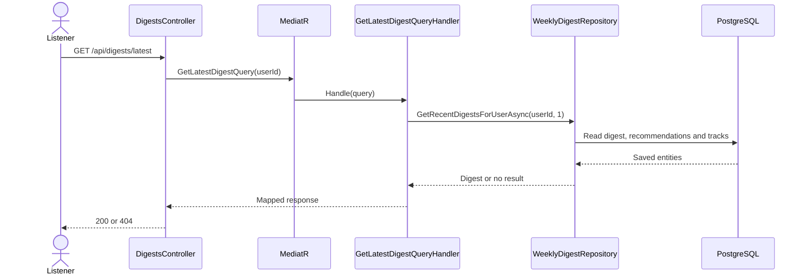
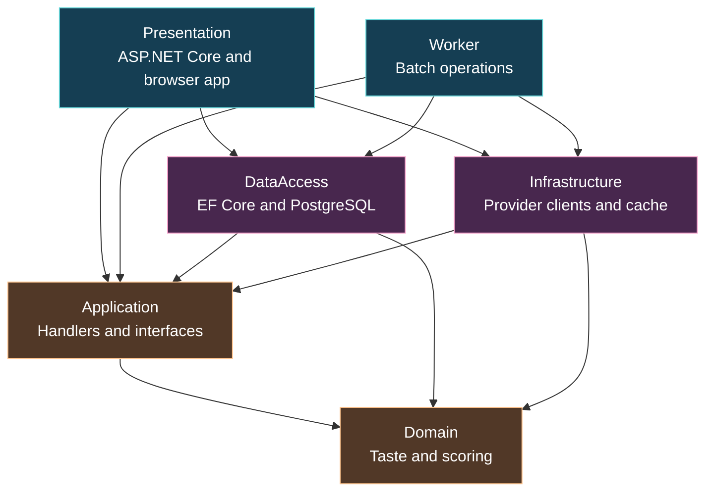
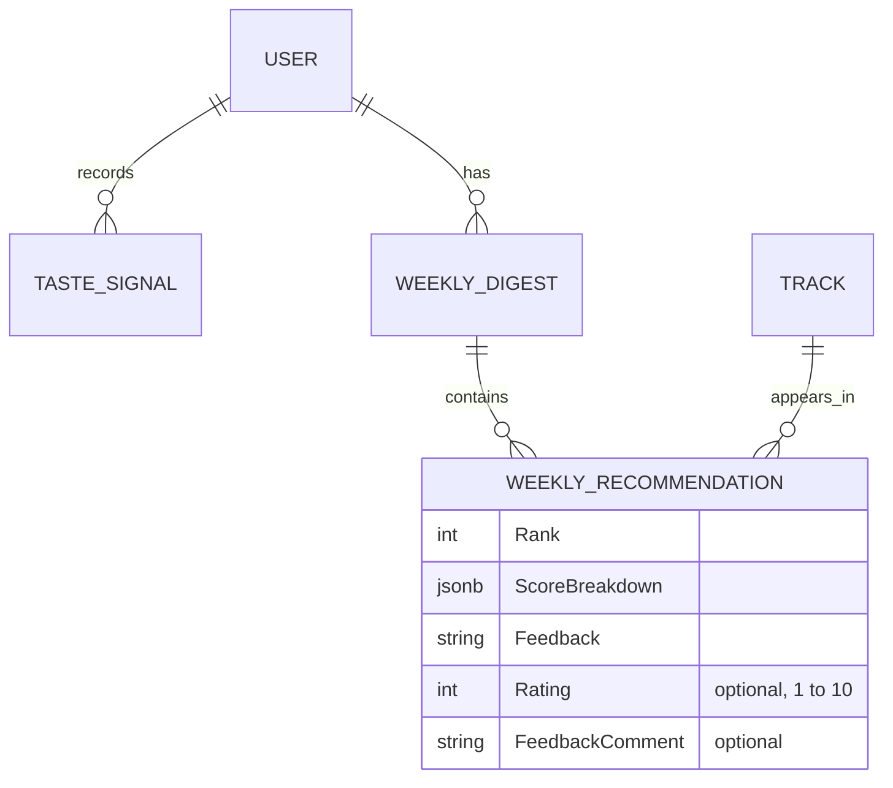
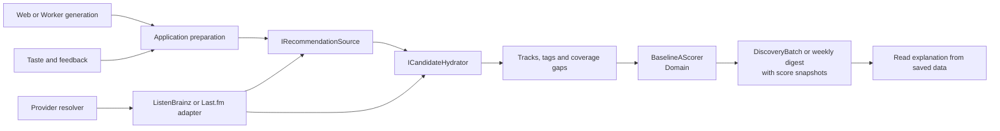

# Developer guide

[Project overview](README.md) · [Progress](PROGRESS.md) ·
[Product contracts](docs/renewal/contracts.md) · [Security policy](SECURITY.md)

This guide is a map of the codebase: where to start, how its main layers fit
together, and where common changes belong. For current implementation status and
open decisions, read [PROGRESS.md](PROGRESS.md); this guide is not a release
readiness statement.

## First steps

If you are new to the repository, this order gives you a quick tour:

1. Read [project conventions](AGENTS.md) and the current [progress report](PROGRESS.md).
2. Open [`src/Presentation/Program.cs`](src/Presentation/Program.cs) to see how
   the web host is assembled.
3. Follow a stored-digest request from
   [`DigestsController`](src/Presentation/Controllers/DigestsController.cs)
   through its query handler and repository.
4. Trace recommendation source and hydration interfaces from
   [`src/Application/Common/Interfaces/Recommendation`](src/Application/Common/Interfaces/Recommendation)
   to their adapters in
   [`src/Infrastructure/RecommendationSources`](src/Infrastructure/RecommendationSources).
5. Read [`BaselineAScorer`](src/Domain/Scoring/BaselineAScorer.cs) and its tests
   before changing ranking behavior.

The provider call path, digest generation and persisted explanation are
separate stages. A page reads saved data; it does not fetch recommendations from
an upstream service.

### Reading a saved digest

This request reads the latest saved digest for the authenticated user. It does
not run discovery or score candidates.



## Repository layout

| Project or folder | What belongs there |
| --- | --- |
| [`src/Domain`](src/Domain) | Taste, catalog and digest models; pure scoring and ranking policy. No external packages. |
| [`src/Application`](src/Application) | Commands, queries, handlers, validation, DTOs and interfaces. Coordinates work without provider-specific HTTP. |
| [`src/DataAccess`](src/DataAccess) | EF Core context, Identity, repositories, entity configuration and migrations. |
| [`src/Infrastructure`](src/Infrastructure) | Music-provider clients, caching, rate limits, evidence parsing and replay. |
| [`src/Presentation`](src/Presentation) | ASP.NET Core host, API controllers, authentication and the React app served from `wwwroot`. |
| [`src/Worker`](src/Worker) | A second host for explicit generation, reconciliation, capture and scheduling operations. |
| [`tests`](tests) | Domain, Application, DataAccess, Infrastructure and Presentation checks. |
| [`scripts`](scripts) | Local setup, offline replay and evaluation, and operational helpers. |
| [`docs`](docs) | Product contracts, setup runbooks, evidence and design records. |

The solution targets **.NET 10**. The SDK is pinned in [`global.json`](global.json);
package versions are centrally managed in [`Directory.Packages.props`](Directory.Packages.props).
Check those files and project references before changing dependencies.

## How the layers connect

Presentation and Worker are composition roots. Their project references bring
in Application and the adapters; dependency direction inside the core ends at
Domain. The arrows below are project references, not request-time calls.



Keep scoring in Domain, orchestration in Application, persistence in
DataAccess, provider-specific behavior in Infrastructure, and HTTP/UI concerns
in Presentation. Add a provider behind the existing Application interfaces so
the provider can change without rewriting product workflows.

## Follow a feature

| Area | Start here |
| --- | --- |
| Account and authentication | [`AuthController`](src/Presentation/Controllers/AuthController.cs) and [`JwtService`](src/Presentation/Services/JwtService.cs) |
| Taste signals | [`TasteController`](src/Presentation/Controllers/TasteController.cs) and [`SeedTasteProfileCommandHandler`](src/Application/Features/Taste/Commands/SeedTasteProfile/SeedTasteProfileCommandHandler.cs) |
| Stored recommendations | [`DigestsController`](src/Presentation/Controllers/DigestsController.cs), [`GetLatestDigestQueryHandler`](src/Application/Features/Digests/Queries/GetLatestDigest/GetLatestDigestQueryHandler.cs) and [`WeeklyDigestRepository`](src/DataAccess/Persistence/Repositories/WeeklyDigestRepository.cs) |
| Feedback | [`RecordRecommendationFeedbackCommandHandler`](src/Application/Features/Digests/Commands/RecordFeedback/RecordRecommendationFeedbackCommandHandler.cs) |
| Scoring | [`BaselineAScorer`](src/Domain/Scoring/BaselineAScorer.cs) and [`tests/Domain.Tests`](tests/Domain.Tests) |
| Export and account deletion | [`ExportController`](src/Presentation/Controllers/ExportController.cs), [`SubscribersController`](src/Presentation/Controllers/SubscribersController.cs) and their Application handlers |
| Browser app | [`src/Presentation/ClientApp`](src/Presentation/ClientApp/README.md) |

For a stored digest, the controller sends a query through MediatR; the handler
uses a repository, then maps the saved digest to an API response. For
recommendation generation, Application asks `IRecommendationSource` for
candidates and `ICandidateHydrator` for provider evidence. Domain scores the
result. The generation store persists selected recommendations and their score
snapshots. These are different flows: reading a digest does not trigger
generation.

Provider responses can be incomplete. Preserve missing evidence as a coverage
gap; do not invent tags, matches or listener counts. The Last.fm HTTP and replay
paths share [`LastFmEvidenceParser`](src/Infrastructure/RecommendationSources/LastFm/LastFmEvidenceParser.cs).
[`RecordedLastFmApiClient`](src/Infrastructure/RecommendationSources/LastFm/RecordedLastFmApiClient.cs)
replays injected immutable response bytes without HTTP or file discovery.

## Data and explanations

Each selected recommendation stores a structured score breakdown. The
explanation is produced from that snapshot by `WhyThisPick()`; it does not use
generated text or make a provider request. If scoring changes, preserve the
snapshot needed to explain existing recommendations and check the benchmark
seed set.

The registered-account digest model centers on users, taste signals and saved
weekly recommendations:



This is a guide to the core relationships, not the full schema. Onsite guest
discovery also stores `DiscoveryBatch` records and recommendation snapshots.

The export and deletion paths cover user data across the application and
Identity schema. Review the [privacy evidence](docs/renewal/phase-8a-evidence.md)
before changing persisted fields, export mappings or deletion behavior. Local
verification is not a substitute for deployment-specific review.

## From taste to a saved pick

This simplified view shows the scoring and persistence boundary. The web and
Worker entry points differ, and the provider adapter supplies the candidate and
tag evidence:



ListenBrainz is the configured default. Provider choice is wired through the
provider resolver, so application workflows do not depend on either adapter.
The Last.fm HTTP and replay clients share
[`LastFmEvidenceParser`](src/Infrastructure/RecommendationSources/LastFm/LastFmEvidenceParser.cs);
the [replay client](src/Infrastructure/RecommendationSources/LastFm/RecordedLastFmApiClient.cs)
uses injected bytes and makes no HTTP calls. The diagram describes the software
path, not recommendation quality or email delivery.

## Local development

Install the SDK version in `global.json`. To restore and build the solution:

```bash
dotnet restore 'Liner Notes.sln'
dotnet build 'Liner Notes.sln' --no-restore
```

To run the actual site with live provider data, follow the
[local website runbook](docs/renewal/local-live-run.md). It covers PostgreSQL,
Presentation User Secrets, the persistent local database and the launcher. The
short version, after setup, is:

```bash
bash scripts/run_live.sh
```

The site opens at `http://localhost:5080/`. The live profile uses ListenBrainz
and MusicBrainz; it does not fall back to synthetic recommendations if live
configuration fails. Do not share this database with synthetic or manual-QA
runs.

For frontend-only work, see the
[ClientApp guide](src/Presentation/ClientApp/README.md). It lists the Node
version, local build, Vite development server and browser checks.

## Tests and checks

Run the solution tests with:

```bash
dotnet test 'Liner Notes.sln' --no-restore
```

Some persistence checks require an explicitly configured disposable PostgreSQL
database. Without one, database-backed checks may skip. The test projects are:

| Project | Focus |
| --- | --- |
| [`tests/Domain.Tests`](tests/Domain.Tests) | Scoring, taste, ranking and architecture boundaries |
| [`tests/Application.Tests`](tests/Application.Tests) | Handlers, validation and orchestration |
| [`tests/DataAccess.Tests`](tests/DataAccess.Tests) | EF models, repositories, transactions and migrations |
| [`tests/Infrastructure.Tests`](tests/Infrastructure.Tests) | Provider parsing, caching, limits and replay |
| [`tests/Presentation.Tests`](tests/Presentation.Tests) | Controllers, authentication and host behavior |

The repository's offline evaluation and documentation checks are separate from
the application test suite. Synthetic fixtures establish mechanics; they do
not measure recommendation quality or provider catalog coverage. See the
[phase evidence](docs/renewal/phase-6-evidence.md) for the scope of generation
verification.

## API entry points

Routes are declared by controllers and use `/api/[controller]`. In Development,
Swagger is available at `/swagger`.

| Route | Purpose |
| --- | --- |
| `POST /api/auth/register`, `/login`, `/refresh` | Create a session or refresh credentials |
| `GET /api/auth/me` | Read the signed-in identity |
| `GET`, `DELETE /api/subscribers/me` | Read or delete the current account |
| `POST /api/taste/seed`, `GET /api/taste/signals` | Save and read taste signals |
| `GET /api/digests/latest` | Read the latest saved digest |
| `POST /api/digests/recommendations/{id}/feedback` | Save feedback for a recommendation |
| `GET /api/export/my-data` | Export the current user's data |
| `GET /health` | Check host health |

This is a route index, not a complete API contract. Check controller models,
validators and authorization attributes for payloads and access rules.

## Before opening a change

- Read [AGENTS.md](AGENTS.md) and the relevant [product contract](docs/renewal/contracts.md).
- Keep provider rules in adapters and scoring policy in Domain.
- Treat popularity neutrally. Do not claim ownership of upstream similarity data
  or a new recommendation algorithm.
- Update [CHANGELOG.md](CHANGELOG.md) for user-visible product changes.
- Keep local commits focused. Do not commit recordings, reports, credentials or
  other private local data.

The [architecture visuals](docs/architecture/README.md) include a dated code
graph snapshot. It can help with orientation, but source code, tests and project
references are the authority.

## Explore the Nebula

[Open the interactive Nebula](https://jafarli-mahammad.github.io/Liner-Notes/?tab=graph&project=LinerNotes). Its graph data is refreshed by successful Pages deployments from `main`; the browser view is interactive, but it is a static snapshot rather than a live MCP connection.


The graph was captured from commit `62a2698` on 2026-10-10. Use it to find
clusters and possible relationships, then confirm those paths in source. It is
not a runtime trace, and its labels and connections are best-effort static
analysis. The [snapshot notes](docs/architecture/README.md) describe its
coverage limits.
