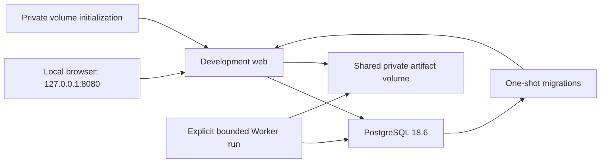

# Phase 9: reproducibility and release preparation

Design approved 2026-10-12 with the correction to use latest stable project
packages and tools; implementation was explicitly requested. MediatR 12.5.0
is the separately approved licensing exception. The [sequential plan](phase-9-plan.md)
is being executed. This does not confirm earlier implementations.

## Intended outcome and current evidence

A new checkout can restore the same dependency graph, build both composition
roots, start a disposable PostgreSQL-backed local application and exercise the
implemented synthetic generation/capture/scheduling slice. CI runs PostgreSQL
checks instead of silently skipping them. Release documentation identifies
missing approvals and operational decisions.

Verified in this checkout:

- `Dockerfile` restores Presentation before copying `Directory.Build.props`,
  which supplies `net10.0`. It builds only Presentation, uses floating image
  tags and copies the entire build context.
- `compose.yaml` has only web: no database, migration step or private storage
  volume. `README-Developer.md` records this gap.
- CI uses a floating SDK and mutable action tags without PostgreSQL.
  `LocalPostgresMigrationFactAttribute` and `ScheduledPostgresTheoryAttribute`
  skip checks without `LINER_PHASE1_POSTGRES`.
- The installed SDK is `10.0.112`. Projects target .NET 10 but reference EF
  Core `9.0.2` and Npgsql EF provider `9.0.4` at preflight. Upgrade to verified
  stable EF `10.0.12` and Npgsql EF `10.0.3`, together with the other direct packages.
- Worker rejects non-Development execution and non-loopback PostgreSQL hosts.
  Scheduling requires Synthetic origin, explicit user IDs and bounded ticks.
  Storage reconciliation is an explicit operator action.
- `/health` checks PostgreSQL. Encryption keys already persist there. Local
  copies are encrypted; generation storage accounts for six artifact categories
  plus an inventory and lease outside their directories.
- Preflight checkout was clean at `868b20e`. Phase 8's recorded 468-check result
  is previous evidence, not verification performed in this task.

## Options and recommendation

1. **Recommended: package the existing local slice and strengthen CI.** Add
   reproducible inputs, explicit migrations, disposable services and release
   documentation around current application contracts.
2. Web image and CI only: smaller scope, but leaves Worker packaging and shared
   capture storage unverified.
3. Production deployment: requires production scheduling, external delivery,
   hosting/capacity/key-custody decisions and provider permissions. Those missing
   decisions require a separate design.

## 9a: build inputs and images

Add `global.json`: SDK `10.0.401`, `rollForward: disable`, prereleases disabled.
Centralize direct and transitive stable versions in `Directory.Packages.props`.
Enable NuGet lock generation in shared build properties and commit locks for
six source and five test projects after the authorized latest stable upgrade.
Verify compatibility and freeze the resulting graph. Docker and CI use
locked restore. This constrains resolution, not byte-identical build output.

Add `.config/dotnet-tools.json` with `dotnet-ef` **10.0.12**, matching the upgraded EF
packages. Restore it explicitly without replacing the global tool.

Refactor the existing Dockerfile with a shared build stage and these targets:

| Target | Contents and purpose |
|---|---|
| `web`, default/final | Published Presentation, ASP.NET runtime, non-root `APP_UID`, port 8080 |
| `worker` | Published Worker, ASP.NET runtime required by existing dependencies, non-root `APP_UID`, existing CLI entry point |
| `tools` | SDK, source, Release build outputs and pinned EF tool; one-shot local migration runner |
| `volume-init` | Create/chown private directories in the task-owned named volume, then exit; root used only for this initialization |

Copy shared properties, SDK/tool manifests, central versions, project files and locks before
restore. Copy only necessary source afterward. Strengthen `.dockerignore` to
exclude local configuration, recordings, captures, keys, inventories, reports
and test output from the build context. Runtime images contain neither SDK nor
migration tools.

Pin SDK, runtime and PostgreSQL images by immutable registry digest. Verify
the selected images contain SDK `10.0.401` and runtime `10.0.12`; record exact
digests and inspected versions in evidence. Cached tags alone are insufficient.
Initial verification supports Linux amd64; other platforms remain unverified.
Reviewed maintenance changes update pins.

## 9b: local Compose topology

Use an explicitly local Development stack. Publish web **only on
127.0.0.1:8080**; PostgreSQL has no host-published port. A helper generates an
ignored environment file with local database credentials and an independent
signing key, using private file permissions, refusing overwrite and printing
no credential values. The supplied local configuration uses FixtureOnly Last.fm
mode and Synthetic generation; it supplies no upstream/provider keys.

Database health gates migrations. Successful migrations and volume initialization
gate web startup. Migration failure prevents startup. Tools apply only existing
migrations using `--context AppDbContext`, Release configuration and existing
environment-based settings. Connection strings are runtime configuration, not
image-layer values or printed command arguments. Normal app startup does not
apply migrations, and this phase adds no schema change.

Worker belongs to an opt-in `local-worker` profile, invoked with Compose `run`.
Use `network_mode: service:db` so Worker reaches PostgreSQL through
`127.0.0.1`, preserving its current loopback guard. Web uses Compose database
DNS. Document this deliberate local topology; retain Worker environment/origin
guards. There is no automatically restarting scheduler.

Both applications use the same absolute paths under `/app/local-state` for
copies, recordings/cache/reports/backups/partials, inventory and lease. The
initializer creates only the dedicated named volume's directories, owned by
the runtime UID with owner-only modes. PostgreSQL has its own persistent volume.
Use `http://127.0.0.1:8080` as the local browser unsubscribe origin.

Document disposable account registration/seeding, explicit reconcile, generate,
reconcile again, capture, bounded schedule, export, unsubscribe and deletion.
Preserve changed-inventory stops and explicit reconciliation. Restart retains
both database keys and encrypted copies. Normal shutdown retains volumes;
destructive cleanup is a separately invoked command targeting only this project.
The existing 1 GB stop stays temporary; local fixture success establishes no
production capacity or larger Last.fm storage permission.

## 9c: CI and release preparation

Update existing CI. Use the latest stable checkout/setup-dotnet actions and pin
verified revisions. Disable persisted checkout credentials, use `contents: read`,
a fixed Ubuntu runner version, bounded timeouts and cancellation of superseded
runs. Trigger on PRs, pushes to `main`/`Prism` and manual dispatch. Add no registry
publishing or deployment job.

The verification job provisions healthy PostgreSQL 18.6 and supplies
`LINER_PHASE1_POSTGRES` for disposable checks. Restore the pinned SDK, tool and
locked packages; build Release; run the full .NET suite, existing fake-input
Python recorder/pilot checks and repository checks. Supply no provider keys and
invoke no live recorder. Validate TRX existence and **zero failed or
skipped/not-executed tests**, without deleting or weakening existing checks.

A container job builds web/Worker/tools images and runs a disposable Compose
startup/migration/health smoke check with generated local credentials. Fail on
container errors. Logs/artifacts exclude credentials, capabilities, message
contents, captures and provider data. Cleanup targets the uniquely named task
project. Local equivalent checks provide local evidence; actual GitHub execution
remains unverified until an authorized remote push/run.

Add a local runbook, evidence report and release checklist; update Progress,
Changelog and the developer guide's Compose paragraph after implementation.
Distinguish local verification, developer confirmation and production readiness.

Written Last.fm public-page approval is **missing**. Record only real approval
references, authorized pages/button/link placements and conditions. A Phase 5
evidence waiver is not public permission. The enquiry remains a draft: sending
it is outside this request. Hosting, external email, production scheduling,
capacity, key/backup protection, deployment and remote publication retain
separate decisions. Phase 9 can become locally verified while release is blocked.

## Acceptance and failure checks

| Requirement | Verification after approval |
|---|---|
| Reproducible restore | Clean locked restore; graph mismatch fails; inspected image versions match recorded pins |
| Build correctness | Release solution build and independent web/Worker/tools image builds |
| Startup ordering | Fresh database migrates before healthy web; repeated migration is idempotent; migration configuration failure prevents startup |
| Isolation and identity | Only loopback web port published; applications run non-root; ignored sentinel secrets/captures absent from build context and runtime images |
| Shared storage | Fabricated capture survives recreation; export/deletion use the same volume; private modes verified |
| Worker boundaries | Synthetic one-shot/bounded schedule works; Production and unsupported origins still fail |
| State transitions | Repeat capture/schedule remains idempotent; unsubscribe suppresses capture; deletion invalidates access and removes owned copies |
| CI completeness | Full suite with PostgreSQL, zero failures/skips; Python/repository checks pass; missing/skipped TRX fails validation |
| Release honesty | Checklist reports missing Last.fm approval and operational decisions; no readiness or catalog-quality claim |

Use the test-cases skill to turn this matrix into executable QA. Existing scoring
and benchmark checks remain in the full suite; no scorer change is proposed.

## Effort, commit sequence and review

Three substantial implementation/verification passes, roughly 2–4 hours with
usable caches. Downloads, image builds and PostgreSQL process checks may extend
that estimate; duration depends on network/cache and check results.

1. Build inputs, tool pin and container targets; verify locked restore, Release
   build and images, then create a focused local commit.
2. Compose, private initialization and runbook; verify startup/failure paths,
   fixture lifecycle and restart, then create a focused local commit.
3. CI/result validation, release checklist and evidence/status/docs; run relevant
   checks and the full suite, then create a focused local commit.

The developer approved this design with the latest stable version correction
and instructed continuation through the sequential implementation plan. Approval
covers the described
SDK/locks, EF tool manifest, container/Compose topology and CI changes; it does
not confirm earlier work or supply public-release permission.

## Primary references checked 2026-10-12

- [.NET containers](https://learn.microsoft.com/en-us/dotnet/core/docker/build-container)
  and [official .NET 10 release metadata](https://raw.githubusercontent.com/dotnet/core/main/release-notes/10.0/releases.json).
- [NuGet locks](https://learn.microsoft.com/en-us/nuget/consume-packages/package-references-in-project-files#locking-dependencies),
  [dotnet-ef 10.0.12](https://www.nuget.org/packages/dotnet-ef/10.0.12) and
  [EF migration deployment](https://learn.microsoft.com/en-us/ef/core/managing-schemas/migrations/applying).
- [Compose startup](https://docs.docker.com/compose/how-tos/startup-order/)
  and [service network mode](https://docs.docker.com/reference/compose-file/services/#network_mode).
- [GitHub .NET CI](https://docs.github.com/en/actions/tutorials/build-and-test-code/net),
  [checkout v4](https://raw.githubusercontent.com/actions/checkout/v4/action.yml)
  and [setup-dotnet v4](https://raw.githubusercontent.com/actions/setup-dotnet/v4/action.yml).
- [Last.fm API terms](https://www.last.fm/api/tos): §2.7 public-page permission,
  §4.3.4 caching/storage and §4.4 provider-set limits. No universal numeric
  request allowance or text-only email permission is asserted.
