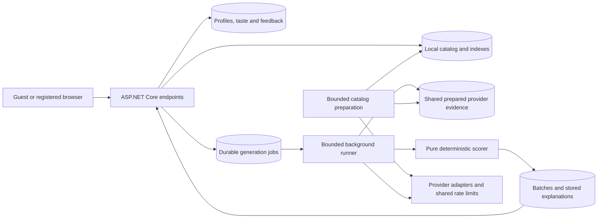

# Guest discovery and immediate recommendations

Date: 2026-10-16

Status: **Proposed design for developer review. Product implementation has not started.**

## 1. Purpose and confirmed requirements

Let a visitor enter favorite artists or albums, choose style tags, and receive useful recommendations on the website during the same visit. They can give feedback and explicitly request another batch. Registration preserves their progress.

Confirmed by the developer:

- Artists, albums, and tags belong in the first release.
- Visitors can try the application as guests before registering.
- Typing searches a prepared local catalog. An explicit online lookup is allowed for missing items.
- An explicit **Discover more** button requests another batch, with a short cooldown.
- The website is the primary experience. Weekly email is separate and requires registration, consent, and a verified address.
- The initial audience is approximately 20–50 people, mainly friends. This is an audience estimate, not a statement that 50 people will generate simultaneously.
- There must be no hard-coded maximum number of users.
- The design must work toward a small deployment: 2–4 GB RAM, modest CPU, and 10–15 GB total storage. Local operation must remain possible without required paid services.
- Efficiency must preserve the discovery flow and its functionality.

The durations, resource budgets, load profiles, and exact data model below are proposals for review, not additional approved decisions or measured results.

## 2. Existing implementation and changes required

Repository inspection found:

- Manual onboarding accepts 3–5 artist/tag signals. There is no album signal or local autocomplete catalog.
- `Domain/Digest/User` requires an email and maps one-to-one to an Identity account. Taste signals and recommendations reference that subscriber.
- `WeeklyDigest` and generation persistence use user/week identity. That identity cannot represent multiple discovery batches in one week.
- Generation already materializes taste, acquires provider candidates, hydrates evidence, scores deterministically, and persists explanations.
- The generation store takes a global PostgreSQL advisory lock before upstream acquisition. Its storage revision also reads all managed rows. These operations need explicit treatment in the new execution path.
- ListenBrainz is the configured default behind the provider boundary; Last.fm remains available. Ordinary local configuration uses synthetic fixtures. Real acquisition, deployment use, and recommendation quality have separate unresolved evidence and usage gates.
- The existing Worker is restricted to Development and a loopback database. It is not a ready production job runner.
- A pre-existing change in `src/Presentation/Services/AuthService.cs` is outside this planning task.

This is a change to identity ownership, batch lifecycle, and data preparation as well as onboarding UI. Reuse the pure scorer and provider contracts where applicable; do not manufacture subscriber emails or use calendar weeks as on-demand request IDs.

## 3. Proposed system layout

Use one ASP.NET Core application and the existing PostgreSQL database for the initial deployment. A bounded background service in the application processes durable database jobs. This avoids requiring a separate always-running job service or another queue database. Job processing must also remain separable from the web process through configuration and shared interfaces later.

Presentation owns HTTP, guest credential handling, DI, and the thin background host. Application owns search, profile, queue, and generation orchestration through interfaces. Domain owns taste materialization, scoring, and batch rules. DataAccess owns PostgreSQL queries, migrations, leases, and persistence. Infrastructure owns provider acquisition, source parsing, and source-specific cache policy.

## 4. Visitor experience and proposed defaults

1. A guest opens the website and enters favorites. Encourage three choices; accept at least one valid input. Proposed input limits are five artists/albums combined and five optional style tags. These replace the existing combined 3–5 validation rule after approval.
2. Artist/album search returns a small local list. Album results include artist and distinguishing metadata; duplicate artist names are disambiguated. Provide an initial curated set of around 40 style tags with searchable labels.
3. If the item is missing, **Search more** performs a deliberate provider lookup. The visitor selects a resolved entity; unresolved free text is not silently assigned to a similarly named entity.
4. Submitting inputs saves the profile and creates one generation job atomically. The browser displays preparation progress, then 3–5 eligible recommendations and their stored explanations.
5. Feedback updates the taste inputs used by subsequent batches. Discover more creates another batch and excludes tracks already recommended to that profile and explicitly excluded material.
6. Proposed cooldown: 30 seconds between accepted generation requests per profile, configurable. First generation has no cooldown. Only one unfinished generation job is allowed per profile; retries and multiple tabs return the same job.
7. Returning in the same browser restores the profile and latest batch without automatic regeneration. Explicitly requesting more remains the trigger for another batch.
8. Registration attaches the current guest profile to the new account without losing its history or feedback. Signing into an account with an existing profile offers an explicit import decision rather than overwriting either profile silently.

When fewer than three eligible picks exist, return the available supported results with a coverage explanation and a way to add or change inputs. Never pad a batch with synthetic picks, repeated tracks, or unsupported claims. Distinguish technical generation success from recommendation-quality evidence.

## 5. Guest profiles, privacy, and account conversion

Introduce a listener profile that can exist independently of a subscriber. It has a stable ID and an optional registered account association. Taste, feedback, recommendation history, and discovery jobs belong to the profile.

A guest receives an unpredictable browser credential in an HttpOnly cookie, with SameSite protection and Secure in HTTPS deployments. Persist only a credential hash. Resolve ownership server-side; never trust a submitted profile ID as authorization. Cookie-authenticated mutations need CSRF protection and origin checks. Local development must remain runnable through its explicitly configured development behavior.

Proposed expiry: delete guest-owned data after seven days of inactivity. Do not retain detailed guest profiles indefinitely. Display this behavior and provide guest export and Clear my data. Update activity timestamps at bounded intervals rather than writing a profile row on every search keystroke. Cleanup runs in bounded batches; merely discovering that expiry is due must not let stale credentials continue to authorize requests. Guests using another browser or clearing their cookie cannot recover that profile without registering.

Account attachment requires proof of ownership of both the account and the guest session and runs transactionally. Rotate/revoke guest credentials after attachment. Concurrent requests, retries, expiry, deletion, and in-flight generation must not recreate or transfer deleted data.

Guest profiles must never enter weekly email scheduling. Account creation alone must not authorize email. The discovery work will preserve these eligibility boundaries; production email transport is outside this feature.

Export and deletion must include the new profile data, inputs, feedback, batches, history, and owned job records. Public shared catalog records are not private listening history. Search queries must not become a permanent per-person search log. Existing account retention must not be silently changed by the new guest expiry rule.

## 6. Discovery batches and migration

Introduce a general discovery batch with profile ownership, request identity, input revision, catalog/evidence version references, timestamps, and ranked recommendations with persisted score breakdowns. Each explicit accepted generation request has its own stable identity. Record already-recommended track identities compactly; do not equate a recommendation with a listen.

Weekly delivery remains a subscriber/week record that refers to a batch. A common generation service produces the picks; weekly delivery and on-demand discovery use their own idempotency rules.

Migration requirements:

- Create profiles for existing registered users while preserving stable ownership mappings.
- Map existing digests into batches and retain existing recommendation IDs, feedback, dates, explanations, and historical weekly references.
- Move taste and recommendation ownership to profiles with explicit foreign keys and indexes.
- Preserve the existing registered history, feedback, export, deletion, and weekly delivery contracts through compatible adapters or deliberate versioning.
- Validate migrations with populated existing data, not only an empty database. Document backup and recovery before applying a migration to a real deployment.

New snapshots must identify their batch and seed types without pretending a guest request is a weekly email. Historical score JSON remains readable. Version changed materialization/evidence schemas and keep explanations reproducible from the stored data.

## 7. Album taste and recommendation evidence

Represent an album using a canonical release-group identity, linked artist identities, display metadata, and provenance. Release groups prevent country editions and routine reissues from appearing as unrelated album choices. Soundtracks, compilations, and multi-artist albums need explicit credited-artist relationships rather than an arbitrary first artist.

Use album-specific tag evidence where available. Candidate discovery may expand through linked artists or album tags using supported provider capabilities; this does not establish an upstream album-similarity endpoint. Do not promise an endpoint until verified.

If album evidence is unavailable, use a clearly identified artist-level fallback with configurable influence, or report the gap when there is insufficient usable evidence. Never describe artist-level tags as tags verified for the album. User-selected style tags can provide additional explicit evidence. Repeated artist/album choices must not multiply influence accidentally.

Preserve popularity neutrality. Weights and limits remain configuration. Extend the existing deterministic materializer and stored evidence; do not introduce ML, generated explanations, or claim ownership of upstream similarities. Run existing benchmark seeds and deterministic regression checks for materialization or scoring changes. Those checks establish mechanics, not real recommendation quality.

## 8. Local catalog, acquisition, and refresh

Keep search metadata compact: canonical IDs, display names, normalized search forms, useful aliases, disambiguation, album–artist links, and version/source references. Keep tag assignments and prepared candidate evidence separately so a searchable name does not imply it is ready for immediate recommendation generation.

Use indexed prefix/token matching and bounded trigram matching where appropriate. Short queries must not fall into unbounded fuzzy scans. Support accents, non-Latin names, aliases, and invariant normalization; verify Turkish and Azerbaijani cases. Proposed response limit: 10 results per page/type, with cancellation, input length limits, and bounded query duration. Debounce browser input by about 150 ms and cancel outdated requests.

Prepare an initial catalog from a permitted source using an operator-run reproducible import. Where practical, stream/filter source data outside the VPS and transfer a compact artifact. Do not require loading the full upstream database on the VPS. Measure names, aliases, album relationships, tags, indexes, and import overhead before selecting the initial catalog size. No artist or album count is yet promised.

Grow and refresh the working catalog through approved bounded preparation and explicit lookups. Cache limits define the retained working set, not a permanent list of permitted artists or users. Pinned user selections and required historical evidence must remain valid when evictable public cache entries are removed.

Maintain manifests with source, license/attribution, acquisition time, normalization version, counts, and integrity hashes. Publish updates atomically; an interrupted import must leave the previous usable catalog available. Budget staging, index creation, and old/new overlap. Refreshes have request, time, byte, and concurrency limits and yield to interactive work.

API response caching must respect endpoint-specific cache directives and retention conditions. A durable public evidence cache requires an explicit source policy; the existing short-lived HTTP cache is not permission to retain all responses indefinitely. Preserve original acquisition time, origin, and response hashes. Do not reuse held-out, evaluation-only, or otherwise restricted recordings as product cache data, or relabel cached live evidence as synthetic or approved recorded evidence.

## 9. First-batch execution and overload behavior

Persist jobs in PostgreSQL with pending, leased/running, retryable, completed, and terminal outcomes. Store attempt limits, lease expiry, next attempt time, requested input revision, progress stage, and safe failure codes. Leases recover work after restart. Use bounded polling with backoff; no live push service is required.

Prepared data should let most supported profiles rank locally. Unprepared profiles acquire missing evidence through the shared provider boundary, coalesce identical acquisitions, and respect shared request pacing across processes and applications on the same upstream IP. Existing provenance, response-size, request-count, live-use, and storage gates remain enforced.

Use separate scheduling for local scoring and rate-limited acquisition so an upstream wait does not occupy the only slot for a fully prepared profile. Start with one local generation slot and one coordinated acquisition lane, then tune against measured CPU, memory, and provider limits. Work must progress fairly between profiles; no caller can monopolize the queue by repeatedly requesting more.

Do not hold a database transaction or global advisory lock during provider HTTP calls. Use per-profile job/request coordination, input-revision checks, and short transactional persistence. Storage reservations remain fail-closed and coordinated across managed writes. Design reservations and accounting so each new discovery does not require holding a global lock while rescanning every historical explanation; prove the accounting invariant and reconciliation behavior before replacing any existing guard.

The browser can poll job status at a bounded interval, initially about two seconds, backing off while hidden. Refreshing the page resumes the same job. Show truthful stages and errors without a fabricated completion percentage. Durable work is not lost merely because the initiating HTTP request disconnects.

No maximum user count is introduced. Per-profile cooldowns, bounded queues, session request limits, short-lived abuse controls, and shared provider limits control work. Resetting a guest cookie must not bypass the total queue and upstream budgets. If pending work reaches a configured capacity, return an honest retryable busy response and retain existing results. Do not create unbounded tasks or promise unlimited throughput. Sustained demand beyond one machine's capacity eventually requires added resources or longer waits.

## 10. Proposed resource and performance budgets

All numbers are initial targets to validate, not measured capacity or runtime settings to apply blindly.

| Area | Initial target or constraint |
| --- | --- |
| Test environment | 2 GB RAM, constrained CPU, 10 GB total filesystem scenario; record actual CPU and disk characteristics |
| App and PostgreSQL memory | Aim for combined steady usage at or below 1.25 GiB and peak at or below 1.5 GiB, leaving host headroom; include caches and background work |
| Application caches | Start with a 64 MiB aggregate byte budget; entry count alone is insufficient |
| Search catalog | Initial working catalog plus indexes target at most 256 MiB; choose actual coverage after measuring |
| Prepared public candidate/evidence cache | Initial target at most 256 MiB; deduplicate across profiles and bound eviction/refresh |
| Total storage | Inventory OS, runtime/images, database, WAL, logs, backups, staging, and private data; preserve at least 20% filesystem headroom |
| Existing managed-write guard | Keep `GenerationStorage__StopBytes` mandatory; reconcile new storage classes and proposed quotas with its current temporary cutoff before writes |
| Local search | Server p95 at most 100 ms at the agreed normal and burst loads; browser/network time measured separately |
| Prepared batch | p95 at most 5 seconds from accepted request to available results at normal load; report queue time separately |
| Unprepared batch | Measure and report provider calls, upstream time, queue time, and completion/failure; no blanket five-second guarantee |

Provisional workload: 50 persisted profiles, five active visitors in normal use, and a burst of 20 simultaneous local searches plus five generation submissions. Separately explore 50 simultaneous active visitors to establish overload behavior. Include prepared and unprepared profiles, requests for more, repeated visits, and enough accumulated history to expose growth costs. These are test scenarios, not registration limits.

Disk pressure first pauses optional refresh/imports and evicts only eligible public cache data. Required writes must fail clearly and safely if reservations cannot be made. Do not silently delete retained account taste/history or weaken the storage guard to keep accepting work. Set the actual deployed quotas only after measuring the complete host inventory.

## 11. Verification and implementation stages

This is a substantial backend change, provisionally eight focused implementation commits plus this design. Each stage must leave a runnable, verifiable state. The catalog measurement stage determines final scope estimates; no delivery date or production-capacity claim is justified yet.

| Stage | Deliverable | Required verification |
| --- | --- | --- |
| 1. Resource and source feasibility | Documented source permissions, bounded acquisition/import manifest, compact catalog/evidence sample, actual size/query/memory measurements | Offline importer/replay mechanics first; explicit gates for any real acquisition; catalog coverage and recommendation readiness reported separately |
| 2. Profiles and batches | Guest-capable owner model, general batch identity, populated-data migration, compatible registered history and weekly adapters | Ownership isolation, unchanged historical IDs/feedback/explanations, populated migration, existing account export/deletion and weekly idempotency |
| 3. Guest lifecycle | Secure guest sessions, expiry, export/deletion, account attachment | CSRF, credential isolation, races, expired sessions, in-flight deletion, duplicate account attachment, guest exclusion from email scheduling |
| 4. Catalog search | Compact importer, local indexed search, explicit online resolution, atomic refresh | Duplicate names, aliases, Unicode, short queries, typo bounds, search cancellation, no upstream calls while typing, missing-item resolution and source gates |
| 5. Taste and prepared data | Album evidence/fallback, tag normalization, shared candidate preparation and cache policy | Seed bounds, overlap/deduplication, sparse album data, multi-artist albums, provenance, cache eviction, parser/replay reuse, scorer benchmarks and determinism |
| 6. Durable generation | Idempotent request endpoint, leases, fair bounded runner, progress, cooldown, repeat suppression, coordinated storage reservations | Multi-tab/retry behavior, restart recovery, stale input revisions, remote wait not blocking prepared profiles, quota races, timeouts, outage recovery, no duplicate recommendations across concurrent requests |
| 7. Website flow | Guest input, results, explanations, feedback, Discover more, resume, registration preservation | Browser coverage of prepared/unprepared/error paths, mobile and keyboard accessibility, double submission, cooldown/status visibility, refresh/resume and conversion |
| 8. Capacity and release evidence | Reproducible constrained-host load report, operating defaults, docs, changelog, focused local commits | Relevant .NET/browser/offline checks; disk and memory pressure, queue fairness, normal/burst/stress loads; full applicable regression gates |

No package changes are currently proposed. If needed during implementation, verify latest stable versions and compatibility; retain the approved MediatR licensing exception.

Each authorized implementation stage ends with relevant verification and a focused local commit. Unrelated work stays excluded; no push is authorized. Failed or unavailable required verification is reported before committing, according to project rules.

## 12. Review and remaining decisions

Review this proposed design before product implementation. Specifically review the guest lifetime, input limits, 30-second cooldown, album fallback, ownership/batch migration, and provisional workload/budgets together. The implementation sequence is a proposed breakdown; it is not authorization to run live acquisition or implement every stage.

Engineering questions to resolve in stage 1 rather than guessing now:

- Which source/artifact permits the required metadata and tag storage for this deployment, and what attribution/refresh rules apply?
- What breadth fits the measured local catalog budget, and what fraction has enough prepared evidence for fast first batches?
- What does the complete host inventory leave available after OS, runtime, database, WAL, and recovery overhead?
- Do actual measurements support the latency targets and proposed cooldown/concurrency? What unprepared-batch latency is acceptable once measured?

After developer review, finalize the written design and a detailed execution plan. The installed brainstorming workflow references a `writing-plans` skill; it was not found in the installed skill directories during this session. The planning deliverable must remain accessible as a repository document rather than assuming that missing skill is available. No implementation skill or product code has been invoked.

## 13. References checked during planning

- [Current project progress](../../../PROGRESS.md)
- [Project conventions and preferences](../../../MEMORY.md)
- [Renewal evidence and acquisition contracts](../../renewal/contracts.md)
- [ListenBrainz operations and existing limits](../../renewal/listenbrainz-provider-runbook.md)
- [MusicBrainz core and supplementary data licensing](https://musicbrainz.org/doc/MusicBrainz_Database#License): names/identities and supplementary tag assignments have different licensing conditions; open-source application licensing does not settle data permissions.
- [MusicBrainz release groups](https://musicbrainz.org/doc/Release_Group): the album concept across editions.
- [MusicBrainz API pacing](https://musicbrainz.org/doc/MusicBrainz_API/Rate_Limiting) and [ListenBrainz API pacing](https://listenbrainz.readthedocs.io/en/latest/users/api/#rate-limiting): limits must be observed independently of local job concurrency.
- [PostgreSQL 16 trigram search](https://www.postgresql.org/docs/16/pgtrgm.html): index support and short-query/full-index-scan caveats.

Documentation was checked during this planning session. This does not establish deployment-specific permissions, live recommendation quality, or measured VPS performance.
